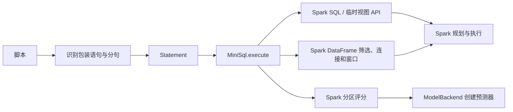

# Spark SQL Mini

这是一个独立的 Scala 项目，在 Spark SQL 外面提供临时视图赋值、追加写表、模型评分、时点快照和时点关联。

```sql
CREATE TABLE output (id BIGINT) USING PARQUET;
temp = SELECT id FROM range(5) WHERE id >= 2;
INSERT temp INTO TABLE output;
SELECT * FROM output ORDER BY id;
```

## 运行

需要 **JDK 17、Maven 3.9+**。依赖固定为 **Spark 4.2.0、Scala 2.13.18**，首次构建会下载 Spark 依赖，不需要另装 Spark、Hadoop 或 Hive 服务。

```bash
cd ~/workspace/spark-sql-mini
./bin/build test
./bin/run examples/minimal.sql
```

示例最终写入并显示两行：

```text
+---+------+
|id |label |
+---+------+
|2  |item-2|
|3  |item-3|
+---+------+
```

运行脚本使用 `local[2]`，并打印本次 `target/runs/run-.../warehouse` 路径；Parquet 数据保留在这里便于观察。表目录使用 Spark 默认的内存目录，进程结束后表定义和临时视图都会消失。每次演示使用新的目录，重复运行不会向上一次演示的数据追加。需要清理时可以删除 `target/`。

`bin/build` 和 `bin/run` 只在当前进程选择 Java：macOS 在未设置 `JAVA_HOME` 时选 JDK 17；已有 `JAVA_HOME` 时使用你指定的版本。不会修改全局配置。`config/jvm.options` 提供直接嵌入 Spark 所需的 JVM 模块访问选项。

## 包装语句的含义

| 输入 | 实际交给 Spark 的操作 |
| --- | --- |
| `temp = SELECT ...` | `spark.sql(query).createOrReplaceTempView("temp")` |
| `INSERT temp INTO TABLE db.output` | `spark.sql("INSERT INTO db.output SELECT * FROM temp")` |
| `INSERT temp INTO TABLE db.output PARTITION (dt = DATE '2026-11-07')` | 把分区说明交给 Spark，向目标分区追加 |
| `scored = SCORE source USING ONNX 'model.onnx' FEATURES (x1, x2) AS model_score` | 在 Spark 分区里推断并追加 `model_score`，再将结果注册成 `scored` |
| `enriched = PIT JOIN samples WITH history ON (id = entity_id) AS OF sample_ts USING feature_ts` | 为每条样本匹配最近的历史记录，再将结果注册成 `enriched` |
| `state = SNAPSHOT history KEY (entity_id) AS OF DATE '2026-11-07' USING effective_on` | 为每个实体选出截至指定时点的最近版本，再将结果注册成 `state` |
| 普通 `CREATE TABLE`、`SELECT`、`EXPLAIN` 等 | `spark.sql(originalSql)` |

赋值右侧接受 `SELECT`、`SCORE`、`PIT JOIN` 或 `SNAPSHOT`。普通 `WITH ... SELECT ...` 可以直接作为原生 SQL 执行。临时视图名和写入源名使用简单英文标识符，如 `temp_1`。目标允许 `output`、`db.output` 等点分名称。普通 SQL 中的标识符、表达式和函数遵循 Spark 本身的规则。

- 同名赋值会替换当前会话中的临时视图；注册视图本身不调用 `show/count/collect`，不自动缓存或物化结果。
- 包装的 `INSERT` 向**已有表追加**，不会自动建表或覆盖旧数据。列按位置匹配，名称不同不会自动重排；列数、类型、权限等问题交给 Spark 报错。
- 多条语句在同一会话中按书写顺序执行，遇到错误立即停止。整个脚本不是事务，前面成功的操作不会回滚。
- 以分号分句，识别单/双引号、反引号、转义、行注释和嵌套块注释；保留 `/*+ ... */` 优化提示。暂不支持包含内部语句分号的 `BEGIN ... END` 等 Spark SQL 脚本块。
- CLI 展示普通查询及独立 `SCORE`、`PIT JOIN`、`SNAPSHOT` 的结果。赋值时打印临时视图的注册信息，查询或写出会触发视图求值。

## 分区写入

目标表用 Spark 原生 `PARTITIONED BY` 定义存储分区。包装层将 `INSERT ... PARTITION` 改写为原生 `INSERT INTO ... PARTITION ... SELECT`，由 Spark 校验分区和列的匹配。

```sql
CREATE TABLE daily_output (id INT, dt DATE, region STRING)
  USING PARQUET PARTITIONED BY (dt, region);

batch = SELECT 1 AS id, 'sg' AS region;
INSERT batch INTO TABLE daily_output PARTITION (dt = DATE '2026-11-07', region);
```

上例固定了 `dt`，而 `region` 取自输入。写入同一分区会追加行。对示例中的 Parquet 表，显式 `PARTITION` 需列出全部分区列。在目标表 `PARTITIONED BY` 定义的顺序中，静态列必须排在动态列之前。输入列按目标表顺序排列，跳过已指定常量的静态列。 [Spark 分区写入实现](https://github.com/apache/spark/blob/v4.2.0/sql/core/src/main/scala/org/apache/spark/sql/execution/datasources/DataSourceStrategy.scala#L178)

| 写法 | `daily_output` 所需的输入列，按顺序 |
| --- | --- |
| `PARTITION (dt = DATE '2026-11-07', region = 'sg')` | `id` |
| `PARTITION (dt = DATE '2026-11-07', region)` | `id, region` |
| `PARTITION (dt, region)` | `id, dt, region` |

## Point-in-Time Join

```sql
enriched = PIT JOIN samples WITH history
  ON (customer_id = entity_id)
  AS OF sample_ts USING feature_ts
  TIE BREAK BY revision;

SELECT sample_id, history_risk_feature FROM enriched ORDER BY sample_id;
```

`ON` 中每个等式左边是样本列，右边是历史列。用逗号列出多个键对时，所有键都需匹配。两侧时间列必须同为 `DATE`、`TIMESTAMP` 或 `TIMESTAMP_NTZ`。Spark 按 `feature_ts <= sample_ts` 筛选候选，再选时间最新的一条。空键和空时间不参与匹配。

结果保留每一条左侧样本，包括重复行。右侧列统一加 `history_` 前缀，找不到历史记录时这些列为 `NULL`。如果最新时点有多个候选，可以用 `TIE BREAK BY` 选右侧值最大的一条，空值排在最后。仍并列时会报错。输出列名冲突时需先重命名输入列。

执行层为样本行加临时编号，用 Spark 左连接找出候选，再用按样本编号分组的窗口排序。临时编号仅用于这次计算。 [实现](src/main/scala/dev/sparksqlmini/temporal/PointInTimeJoin.scala)

```bash
./bin/run examples/pit_partition.sql
```

示例里，10:00 的样本得到 `0.25`，10:30 的样本得到修订版本 2 的 `0.65`，没有历史的样本得到 `NULL`。最后三行写入 `dt=2026-11-07` 的 Parquet 分区，并用 `SHOW PARTITIONS` 查看分区。 [完整示例](examples/pit_partition.sql)

`USING <历史时间列>` 后可加 `LOOKBACK 2 DAYS`，为每条样本限定候选区间 `[样本时间减两天, 样本时间]`。`LOOKBACK 0 DAYS` 仅匹配同一时点，省略时向过去不限时长。对于带时区语义的时间戳，按 Spark 会话时区计算日历日。没有合格历史的样本依然保留。需要限制历史侧存储日期时，把下面的 `READ PARTITIONS` 放在语句末尾。

## 时点快照与历史分区读取

```sql
daily_state = SNAPSHOT status_history KEY (entity_id)
  AS OF DATE '2026-11-07' USING effective_on
  TIE BREAK BY revision
  READ PARTITIONS ingested_on FROM DATE '2026-11-05' TO DATE '2026-11-08';

SELECT entity_id, status, effective_on, ingested_on FROM daily_state ORDER BY entity_id;
```

`SNAPSHOT` 为每组 `KEY` 选出业务时间小于或等于 `AS OF` 的最新一行，保留原表的列，也可直接执行。支持复合键。空键和空业务时间会被排除。最新时点并列时，`TIE BREAK BY` 取最大值，空值排在最后，仍并列会报错。`AS OF` 接受与业务时间列同类型的 `DATE`、`TIMESTAMP`、`TIMESTAMP_LTZ` 或 `TIMESTAMP_NTZ` 字面量，普通 `TIMESTAMP` 遵循 Spark 会话配置。 [Spark 日期与时间戳字面量](https://spark.apache.org/docs/4.2.0/sql-ref-literals.html#datetime-literal)

`READ PARTITIONS` 是可选的存储日期范围，两端都包含，列类型必须是 `DATE`。Spark 将它应用在快照排序或 PIT Join 之前。对于支持分区裁剪的表，且该列确实是存储分区列，可在 `EXPLAIN FORMATTED` 中查看扫描的 `PartitionFilters`。省略该子句时，查询使用源表已有的历史范围。

上例把 `effective_on` 作为业务有效日期，把 `ingested_on` 作为入库分区。11 月 8 日入库、11 月 6 日生效的修订可以进入 11 月 7 日的业务快照，11 月 9 日才生效的记录会被排除。若要复现 11 月 7 日时已知的状态，并且入库日期代表可见日期，就把分区上限也设为 11 月 7 日。缺少的日期分区按空数据处理。缩短分区范围可能排除存放在范围外、当时仍有效的实体版本。

```bash
./bin/run examples/history_snapshot.sql
```

示例先写入分区 Parquet 表，再查看快照和分区裁剪计划，最后用同一张历史表演示 PIT Join 回看。 [完整示例](examples/history_snapshot.sql)

## 使用 ONNX 给表评分

```bash
./bin/run examples/score.sql
```

```sql
scored = SCORE features USING ONNX 'examples/models/linear.onnx'
  FEATURES (x1, x2) AS model_score;

SELECT id, model_score FROM scored ORDER BY id;
```

`features` 可以是表或临时视图。`FEATURES` 指定模型收到的列及顺序。评分结果保留所有原列，并追加一个 `DOUBLE` 类型的 `model_score`。使用赋值形式可将结果交给下一条 `SELECT` 或 `INSERT`。独立 `SCORE` 语句直接返回结果。示例模型计算 `2*x1 - x2 + 0.5`，三行的分数依次是 `2.25`、`1.5`、`-1.5`。

模型路径指向 Driver 上的单个 ONNX 文件。CLI 的相对路径从项目根目录解析。路径中的单引号用 `''` 表示。首版接收一个 `[batch, features]` 的 FLOAT32 输入，以及一个形状为 `[batch]` 或 `[batch, 1]` 的 FLOAT32 或 FLOAT64 分数输出。输入的 batch 维度为动态或 `1`，推断逐行执行。特征必须为可转换成有限 FLOAT32 的非空数值。

`TableScoring` 在 Driver 检查列和读取模型字节。Spark 随任务分发字节，各个非空分区在 Executor 中打开并复用自己的预测器，任务结束时释放会话。预测器接口接收有序的 `Double` 特征，ONNX 适配器负责转换为 `FLOAT32`。后续后端可以实现 `ModelBackend`，并在 `TableScoring` 中注册。 [ONNX Runtime Java API](https://onnxruntime.ai/docs/get-started/with-java)

示例已附模型文件。若要重新生成，可以运行 `uv run --no-project examples/models/generate_linear.py`。

## 先读哪几个文件

1. [Statement.scala](src/main/scala/dev/sparksqlmini/Statement.scala) 定义包装层和原生 SQL 的语句类型。
2. [MiniSql.scala](src/main/scala/dev/sparksqlmini/MiniSql.scala)：核心解释器，直接对照上面的语义表阅读。
3. [StatementParser.scala](src/main/scala/dev/sparksqlmini/StatementParser.scala)：只识别包装语法，不解析 SELECT 内部；分句器避免把字符串中的分号误当分隔符。
4. [Main.scala](src/main/scala/dev/sparksqlmini/Main.scala)：启动本地 Spark、依次执行、展示结果、关闭会话。



详细跟读见 [从一段脚本走到 Spark](docs/walkthrough.md)。评分的分区执行和模型适配分别在 [TableScoring.scala](src/main/scala/dev/sparksqlmini/scoring/TableScoring.scala) 和 [OnnxBackend.scala](src/main/scala/dev/sparksqlmini/scoring/OnnxBackend.scala)。

## 测试

```bash
./bin/build test
```

解析测试覆盖分句、原生 SQL 透传和扩展语法校验。集成测试启动真实本地 Spark，验证 Parquet 写入、临时视图语义、ONNX 评分、快照版本选择、PIT Join 回看边界，以及 Parquet 扫描计划中的分区裁剪。

在自己的 Scala 程序中，可传入已有会话使用同一个解释器：

```scala
val mini = new MiniSql(spark)
mini.run("temp = SELECT 1L AS id; INSERT temp INTO TABLE output;")
spark.table("output").show()
```

解释器不持有全局 SparkSession，也不负责关闭调用方传入的会话；CLI 才负责会话生命周期。

## 官方依据

- [Spark 下载与 Maven 坐标](https://spark.apache.org/downloads.html)
- [Spark 4.2.0 运行环境](https://spark.apache.org/docs/4.2.0/)
- [Dataset、临时视图与惰性求值](https://spark.apache.org/docs/4.2.0/api/scala/org/apache/spark/sql/Dataset.html)
- [INSERT TABLE 的原生语义](https://spark.apache.org/docs/4.2.0/sql-ref-syntax-dml-insert-table.html)
- [Spark JavaModuleOptions](https://github.com/apache/spark/blob/v4.2.0/launcher/src/main/java/org/apache/spark/launcher/JavaModuleOptions.java)
